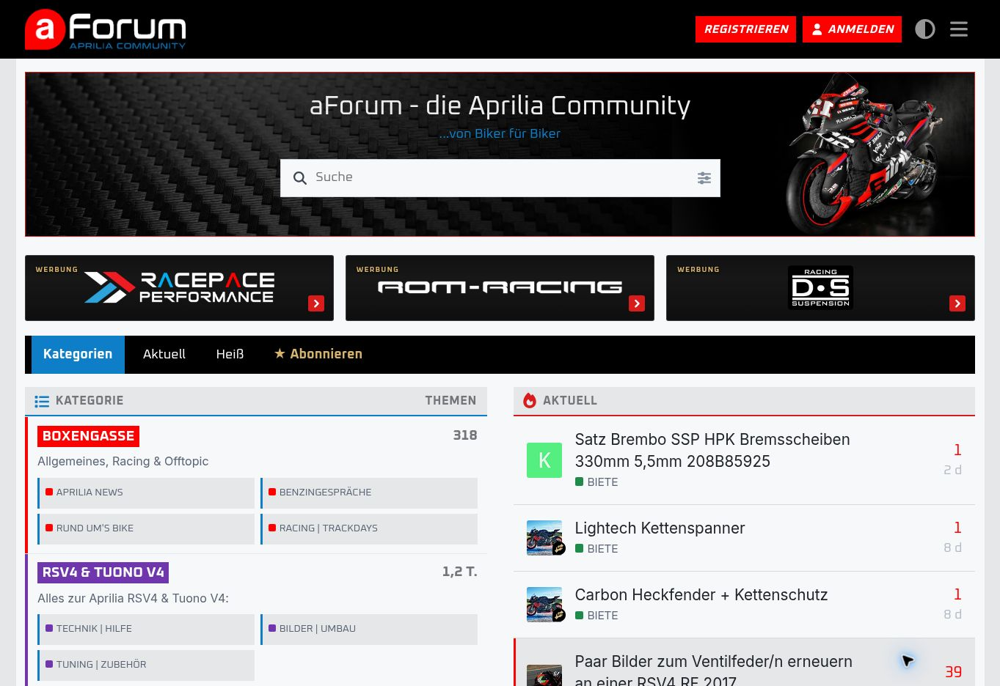

<div align="center">

# aForum Premium Sponsors

### Starke Partner. Klarer Auftritt.

**Die Sponsorleiste für Discourse – entwickelt für die Aprilia-Community.**


[**Live ansehen →**](https://aforum.net) · [Installation](#installation) · [Partner einrichten](#partner-einrichten) · [Einstellungen](#einstellungen) · [Änderungen](CHANGELOG.md)

</div>

---



*Die öffentliche Startseite von [aForum.net](https://aforum.net), aufgenommen am 30. Oktober 2026. Die drei Sponsor-Kacheln zwischen Willkommensbanner und Navigation stammen aus dieser Komponente. Header, Banner, Navigation und Themenübersicht gehören zur übrigen Foreneinrichtung. Die Live-Konfiguration verwendet hier 90 px Kachelhöhe und 3 px Eckenradius; die Komponenten-Standardwerte sind 125 px und 7 px.*

## Sichtbarkeit für die Partner deiner Community

aForum Premium Sponsors bringt bis zu drei Werbepartner direkt vor die Forennavigation. Große Logos, einheitliche Kacheln und ein klarer Link-Pfeil sorgen für einen ruhigen, gut erkennbaren Sponsorbereich.

Auf schmalen Bildschirmen wird ein einzelner Partner angezeigt. Seine Auswahl lässt sich gewichten – so bleibt die mobile Seite kompakt, während wichtige Partner häufiger zum Zug kommen können.

## Funktionen auf einen Blick

| Funktion | Verhalten |
| --- | --- |
| **Bis zu drei Partner** | Gleich breite Desktop-Kacheln in einem dreispaltigen Raster. |
| **Eine mobile Kachel** | Bis einschließlich 760 px wird nur der ausgewählte Partner angezeigt. |
| **Gewichtete Auswahl** | Individuelles Gewicht von 0–20; 0 schließt einen Partner auf Mobilgeräten aus. |
| **Uploads oder externe Bilder** | Direkt hochgeladenes Bild hat Vorrang vor einer externen Bildadresse. |
| **Proportionale Darstellung** | Logo und Banner werden mit `object-fit: contain` eingepasst. |
| **Individuelle Bildgröße** | Bildskalierung je Partner von 90–110 %, unabhängig von Kachel und Beschriftung. |
| **Einheitliche Gestaltung** | Kachelhöhe, Eckenradius und Farbe der Kennzeichnung zentral einstellbar. |
| **Klare Werbekennzeichnung** | „WERBUNG“, benannter Link und rotes SVG-Chevron ohne Icon-Bibliothek. |
| **Hover & Tastaturfokus** | Kachel hebt sich bei Hover oder sichtbarem Fokus an und erhält eine rote Kontur. |
| **Externe Ziele** | Öffnen in einem neuen Tab mit `rel="noopener noreferrer sponsored"`. |

## Installation

1. In Discourse **Administration → Darstellung / Erscheinungsbild → Themes & Komponenten** öffnen.
2. **Installieren → Aus einem Git-Repository** wählen.
3. Diese URL eintragen:

   ```text
   https://github.com/ff4f-git/aForum-Premium-Sponsors
   ```

4. **aForum Premium Sponsors** dem gewünschten aktiven Haupttheme zuweisen.
5. In den Komponenteneinstellungen unter **sponsors** die Partner anlegen und eigene Bilder hinzufügen.
6. Die Startseite neu laden und die Desktop- sowie Mobilansicht prüfen.

Die Komponente wird mit einer leeren Sponsorenliste ausgeliefert. Ohne geeignete Einträge erscheint keine Sponsorleiste. Das [aForum-Haupttheme](https://github.com/ff4f-git/aForum-Theme) wird separat verwaltet.

### Wo erscheint die Sponsorleiste?

Die Komponente fügt ihren Bereich direkt vor `#main-outlet .navigation-container` ein. Bei der aForum-Anordnung sitzt sie dadurch unter dem Willkommensbanner.

| Adresse | Anzeige |
| --- | --- |
| `/` | Immer vorgesehen, sofern Partner und Navigationsanker vorhanden sind |
| `/categories`, `/latest`, `/new`, `/top`, `/hot` | Bei aktiviertem `show_on_categories` |
| Andere Pfade, etwa einzelne Themen oder Unterkategorie-Adressen | Keine Sponsorleiste |

**Wichtig:** Trotz seines Namens schaltet `show_on_categories` die zusätzlichen Hauptreiter gemeinsam. Ausschalten entfernt die Leiste nicht von `/`. Unterpfade oder andere Routen werden vom aktuellen Code nicht mit erfasst.

## Partner einrichten

Unter **sponsors** wird jeder Partner als eigener Eintrag gepflegt.

| Feld | Bedeutung | Verhalten ohne Angabe |
| --- | --- | --- |
| `name` | Partnername; Pflichtfeld. Wird als Bild-Alternativtext und zugängliche Link-Beschriftung verwendet. | Im Editor erforderlich |
| `url` | Zieladresse; Pflichtfeld. Für externe Partner eine vollständige HTTPS-Adresse eintragen. | Im Editor erforderlich |
| `image` | Bild direkt im Discourse-Editor hochladen. | Es wird `image_url` geprüft |
| `image_url` | Alternative Bildadresse, vorzugsweise HTTPS. | Ohne Bild wird die Kachel trotzdem erstellt |
| `mode` | `banner` oder `logo`; beide passen Bilder proportional ein. Banner erhalten zusätzlich einen dunklen Verlauf. | `banner` |
| `background` | Kachelhintergrund als HEX-Wert, z. B. `#171717`. | `#171717` |
| `active` | Partner aktivieren oder deaktivieren. | Aktiv, sofern nicht ausdrücklich `false` |
| `position` | Reihenfolge, aufsteigend. | `0` |
| `image_scale` | Bildskalierung von 90–110 %. | `100` % |
| `mobile_weight` | Gewicht bei der mobilen Auswahl von 0–20. | `1` |
| `tagline` | Vorhandenes Datenfeld für einen Slogan. | Wird aktuell nicht ausgegeben |

### Welche Partner werden berücksichtigt?

Zuerst werden ausdrücklich deaktivierte Partner und Einträge ohne akzeptierte Zieladresse ausgeschlossen. Danach wird nach `position` sortiert; **die ersten drei verbleibenden Einträge** bilden die Sponsorleiste und den Pool für die mobile Auswahl.

Auf Desktop bleiben bei nur einem oder zwei Partnern die übrigen Rasterplätze frei. Ein vierter aktiver Partner wird weder auf Desktop angezeigt noch in die mobile Auswahl aufgenommen.

### Beispiel für einen Partner

Diese Werte werden in den Feldern des Sponsoren-Editors eingetragen; ein eigener JSON-Import ist nicht erforderlich.

| Feld | Beispiel |
| --- | --- |
| `name` | Mein Werbepartner |
| `url` | `https://example.com` |
| `image` | Eigenes Logo hochladen |
| `mode` | `logo` |
| `background` | `#171717` |
| `active` | An |
| `position` | `1` |
| `image_scale` | `100` |
| `mobile_weight` | `3` |

## Gewichtete mobile Auswahl

Bis einschließlich **760 px Bildschirmbreite** wird ein Sponsor aus den maximal drei berücksichtigten Partnern angezeigt.

| Partner | Gewicht | Ungefähre Auswahlwahrscheinlichkeit |
| --- | --- | --- |
| A | 3 | 60 % |
| B | 1 | 20 % |
| C | 1 | 20 % |

- Fehlendes Gewicht entspricht `1`.
- Gewicht `0` schließt einen Partner nur von der mobilen Auswahl aus; auf Desktop bleibt er sichtbar.
- Sind alle berücksichtigten Gewichte `0`, bleibt der mobile Sponsorbereich ohne sichtbare Kachel.
- Die Zufallsauswahl bleibt bei DOM-Neurendern stabil, solange der Partner-Pool unverändert ist. Ein vollständiges Neuladen kann einen anderen Partner wählen.

Die Gewichte bestimmen Wahrscheinlichkeiten, **keine garantierten Ausspielquoten**. Die Komponente enthält weder eine Impression-Zählung noch Klickstatistiken oder eine zeitgesteuerte Rotation.

## Einstellungen

Neben der Sponsorenliste stehen vier globale Optionen zur Verfügung.

| Einstellung | Standard | Bereich / Funktion |
| --- | --- | --- |
| `sponsors` | Leer | Partnerdaten und individuelle Optionen |
| `show_on_categories` | An | Anzeige zusätzlich auf den unterstützten Hauptreitern |
| `tile_height` | `125` px | Einheitliche Kachelhöhe, 90–300 px |
| `corner_radius` | `7` px | Kachel-Eckenradius, 0–40 px |
| `ad_label_color` | `#D6B36A` | Farbe der Kennzeichnung „WERBUNG“ |

Hintergrund- und Kennzeichnungsfarben akzeptieren `#RGB` oder `#RRGGBB`. Ein ungültiger Wert fällt im aktuellen Code auf `#171717` zurück.

Der rote Pfeil skaliert mit der Kachelhöhe: 23 % der Höhe, begrenzt auf 22–55 px. Sein Eckenradius folgt der Kachel, maximal 18 px.

## Bilder, die gut wirken

- **Logos:** transparente PNG- oder WebP-Dateien mit möglichst wenig leerem Rand.
- **Banner:** als Ausgangspunkt ein Querformat wie 1200 × 500 px; die Bildfläche wird proportional eingepasst.
- **Feinabstimmung:** Mit `image_scale` lässt sich ein zu klein oder zu groß wirkendes Motiv korrigieren.
- **Wenig Text im Bild:** Die mobile Kachel nutzt dieselbe Höhe wie auf Desktop, bietet aber eine andere Breite.

Das Bild selbst bleibt proportional; Beschriftung und Pfeil skalieren nicht mit `image_scale`. Die Kachel begrenzt überstehende Inhalte. Hochgeladene Bilder und externe Bilder werden nicht in diesem Repository mitgeliefert.

## Technischer Aufbau

| Datei | Aufgabe |
| --- | --- |
| [`about.json`](about.json) | Registrierung als Discourse-Theme-Komponente |
| [`settings.yml`](settings.yml) | Sponsor-Schema und globale Einstellungen |
| [`common/common.scss`](common/common.scss) | Raster, Bilddarstellung, Werbelabel, Pfeil und mobile Regeln |
| [`javascripts/discourse/api-initializers/aforum-sponsors.js`](javascripts/discourse/api-initializers/aforum-sponsors.js) | Routenprüfung, Partnerauswahl und Einfügen vor der Navigation |
| [`docs/images/`](docs/images/) | Dokumentations-Screenshot |
| [`CHANGELOG.md`](CHANGELOG.md) | Zusammengefasste Entwicklungsschritte |

Der Initializer nutzt die Discourse-Plugin-API und beobachtet Seitenwechsel sowie DOM-Änderungen. Der Einbaupunkt ist ein CSS-/DOM-Anker, kein fest zugesicherter Plugin-Outlet. Fehlt die Navigation oder ändert sich deren Struktur, erscheint die Leiste nicht.

## Wenn etwas nicht erscheint

| Beobachtung | Prüfen |
| --- | --- |
| Gar keine Sponsorleiste | Komponente dem aktiven Theme zugewiesen? Partner aktiv und Zieladresse gültig? Navigationsanker auf dieser Seite vorhanden? |
| Auf einem Hauptreiter fehlt die Leiste | `show_on_categories` aktiv und Pfad in der unterstützten Liste? |
| Mobil keine Kachel | Hat mindestens einer der ersten drei Partner ein Gewicht größer als 0? |
| Neuer Partner fehlt | Reihenfolge kontrollieren: berücksichtigt werden höchstens drei Einträge. |
| Falsches oder fehlendes Bild | `image` hat Vorrang. Eine belegte, aber nicht akzeptierte Upload-Adresse fällt nicht automatisch auf `image_url` zurück. |
| Änderung noch nicht sichtbar | Nach Speichern die Seite vollständig neu laden; eine vorhandene Leiste wird nicht bei jeder DOM-Änderung neu aufgebaut. |

Eine konkrete Mindestversion von Discourse ist derzeit nicht dokumentiert. Nach Discourse- oder Theme-Updates insbesondere Position, Bilddarstellung und mobile Auswahl prüfen. Für Fehlerberichte helfen URL/Pfad, Discourse-Version, aktives Haupttheme, Bildschirmbreite und ein Screenshot.

## Lizenz & Bildmaterial

[`about.json`](about.json) verweist auf die [MIT-Lizenz](https://opensource.org/licenses/MIT). Eine separate `LICENSE`-Datei ist im aktuellen Repository nicht enthalten. Logos und Marken im Screenshot dienen der Dokumentation der Live-Einrichtung; die Komponente liefert diese Bilddateien nicht mit.

---

<div align="center">

**Partner sichtbar machen. Community unterstützen.**

Entwickelt für [aForum.net – die Aprilia-Community](https://aforum.net).<br>
Passendes Haupttheme: [aForum Theme](https://github.com/ff4f-git/aForum-Theme).

</div>
